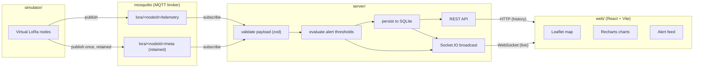

# IoT LoRa Dashboard

A real-time environmental monitoring dashboard for a fleet of LoRa sensor nodes, built as an
open-source reference architecture: **simulated sensors → MQTT → a Node/TypeScript backend →
REST + WebSocket → a React dashboard**.

> **This is a simulated-sensor demo, not connected to real hardware.** There is no LoRa radio,
> gateway, or physical sensor anywhere in this repo. The `simulator/` package generates synthetic
> telemetry (temperature, humidity, gas/smoke ppm, battery, GPS) and publishes it over MQTT using
> the same message shape a real LoRaWAN application server would hand off after decoding uplinks.
> Simulating the sensor layer like this is standard practice for IoT portfolio/reference projects
> where the interesting engineering is in the ingestion, alerting, and real-time dashboard layers,
> not in owning a rack of radios. See "Scope & honesty note" below for specifics.

## What this demonstrates

- Ingesting a stream of noisy, semi-realistic device telemetry over MQTT (pub/sub, QoS, retained
  metadata messages).
- Turning that stream into persisted history plus live alerting with simple, testable
  threshold-evaluation logic.
- Serving both a REST API (historical queries, downsampled/aggregated series) and a WebSocket feed
  (live readings + alerts) off the same data.
- A React dashboard that reads live telemetry on a map, per-metric charts, and an alert feed - the
  kind of operational UI a fleet of environmental sensors actually needs.

## Architecture



Data flow, end to end:

1. Each virtual node in `simulator/` maintains its own slowly-drifting baseline (temperature,
   humidity, gas ppm, battery, GPS) and publishes a JSON reading on `lora/<nodeId>/telemetry` every
   `PUBLISH_INTERVAL_MS`. Node metadata (name, install location) is published once, retained, on
   `lora/<nodeId>/meta`.
2. `server/` subscribes to both topics, validates every payload with `zod` (untrusted input off
   the wire is never trusted blindly), evaluates it against alert thresholds, persists the reading
   and any resulting alert to SQLite, and broadcasts `reading` / `alert` / `node-status` events
   over Socket.IO.
3. `web/` loads history over REST on first load, then patches in live updates from the Socket.IO
   feed - no polling.

## Why SQLite instead of Postgres/TimescaleDB

The `readings` table is laid out in a time-series-friendly way (append-only rows keyed by
`(node_id, ts)` with a covering index), but the storage engine itself is plain SQLite via
`better-sqlite3`, not Postgres. For a demo whose entire point is `docker compose up` getting you to
a working dashboard in a couple of minutes, a single-file embedded database means one fewer
container to provision, tune, and back up. The query patterns here (latest reading per node,
time-range scan per node, simple bucketed aggregation) would translate directly onto a Postgres +
TimescaleDB hypertable if this needed to scale past what a single SQLite file comfortably handles -
that would be the natural next step for a production version of this architecture, not a redesign.

## Repository layout

```
simulator/   Node.js + TypeScript. Generates and publishes synthetic sensor telemetry over MQTT.
server/      Node.js + TypeScript (Express + Socket.IO). MQTT ingest, SQLite persistence,
             alert evaluation, REST API, WebSocket broadcast.
web/         React + TypeScript + Vite. Real-time dashboard (map, charts, alert feed).
mosquitto/   Minimal Mosquitto broker config used by docker-compose.
```

Each package is independently `npm install`-able (none of them import from one another - they only
share an MQTT/JSON wire contract) but are wired together as npm workspaces at the root for
convenience (`npm install` once, run any package's scripts via `--workspace`).

## Quick start (Docker)

Requires Docker and Docker Compose.

```bash
git clone <this-repo>
cd iot-lora-dashboard
docker compose up --build
```

This starts four containers: `mosquitto` (broker), `simulator` (publishes synthetic telemetry),
`server` (REST on `:4000` + Socket.IO), and `web` (dashboard on `:5173`, a `vite preview` build -
see `web/Dockerfile` for why it's not a hot-reloading dev server). Once it's up:

- Dashboard: http://localhost:5173
- REST API: http://localhost:4000/api/nodes, http://localhost:4000/api/alerts
- MQTT broker: `localhost:1883`

Override defaults (node count, alert frequency, etc.) by copying `.env.example` to `.env` first.

## Quick start (local dev, no Docker)

Requires Node.js 20+ and a running MQTT broker. If you don't want to install Mosquitto locally,
the `docker compose up mosquitto` command above will start just the broker.

```bash
npm install                     # installs all three workspaces

# terminal 1: broker (skip if you already have one running on :1883)
docker compose up mosquitto

# terminal 2: backend
cp server/.env.example server/.env
npm run dev:server

# terminal 3: simulator
cp simulator/.env.example simulator/.env
npm run dev:simulator

# terminal 4: frontend
cp web/.env.example web/.env
npm run dev:web
```

Open http://localhost:5173. Within a few seconds of the simulator starting you should see node
markers appear on the map and readings streaming into the chart. Alert episodes are enabled by
default (`ALERT_MODE=random` in `simulator/.env.example`) and fire periodically on a random node -
watch the alert feed and the map marker color change from green to amber to red as one plays out.

## Configuration

Each package documents its own environment variables in `<package>/.env.example`:
`simulator/.env.example`, `server/.env.example`, `web/.env.example`. The root `.env.example` covers
the variables `docker-compose.yml` reads (node count, alert frequency, CORS origin, the API URL
baked into the web build).

## Screenshots

Not included in this repo (no fabricated images) - here's what you'd see and how to generate your
own after running either quick-start above:

- **Dashboard overview**: open http://localhost:5173. You'll see a Leaflet map of the node fleet
  (color-coded green/amber/red by status), a per-node metric chart with selectable
  temperature/gas/battery tabs and warning/alert reference lines, a node list sidebar, and an alert
  feed. Screenshot the whole window.
- **An alert in progress**: wait for the simulator's log to print
  `triggering simulated alert episode on node-XX` (every ~45s by default, see
  `simulator/.env.example`), then screenshot the map (one marker turns red) and the alert feed
  (new entries appear in real time).
- **REST responses**: `curl http://localhost:4000/api/nodes | python3 -m json.tool` or open
  http://localhost:4000/api/alerts in a browser for raw JSON, if you want an API-shape screenshot
  instead of the UI.

## Testing

```bash
npm test               # runs simulator, server, and web test suites
npm run lint            # ESLint across all three packages
npm run format:check    # Prettier
```

- `simulator/test/` covers the noise/clamping helpers and the alert-episode state machine (ramp →
  hold → decay → back to idle) on the virtual node.
- `server/test/` is the most substantial suite: pure-function tests for alert-threshold evaluation
  (`alerts/thresholds.ts`) and time-bucketed aggregation (`alerts/aggregate.ts`), MQTT payload
  parsing/validation tests, an ingest-pipeline test that exercises persistence + alerting together
  against an in-memory SQLite database, a supertest-driven REST API test suite, and a Socket.IO
  test that boots a real `socket.io-client` against a real (ephemeral-port) `socket.io` server to
  confirm live broadcast actually reaches a connected client. All of it runs offline - no MQTT
  broker or external database required.
- `web/test/` covers the pure formatting helpers and a couple of components (`StatusBadge`,
  `NodeList`) with React Testing Library.

## What was actually verified, and how

In the interest of not overstating what "done" means for a demo repo:

- **Verified live, end-to-end, with real processes**: a real MQTT broker (not mocked), the actual
  compiled `simulator` publishing synthetic telemetry, and the actual compiled `server` subscribing,
  persisting to SQLite, evaluating thresholds, and serving both REST and Socket.IO. This was
  exercised by hand (curling `/api/nodes`, `/api/nodes/:id/readings` with and without `bucketMs`,
  `/api/alerts`, and connecting a real `socket.io-client` and observing `node-status`, `reading`,
  and `alert` events arrive as the simulator ran) and confirmed alert episodes correctly escalate
  node status from normal → warning → alert and back down as they decay.
- **Verified via automated tests, run and passing**: all three workspaces' test suites (79 tests
  total at last count), plus `tsc`/ESLint/Prettier clean, plus production builds succeeding, for
  all three packages.
- **Not verified in this environment**: `docker compose up` itself was not run against Docker,
  because Docker wasn't available in the sandbox this was built in. The Dockerfiles and
  `docker-compose.yml` were written and reviewed carefully (multi-stage where it matters, explicit
  `EXPOSE`/`CMD`, environment variables threaded through consistently) but you should treat the
  Docker path as "should work, please file an issue if it doesn't" rather than "verified" until
  someone runs it. The MQTT broker used for the live verification above was a real, spec-compliant
  broker (`aedes`, run standalone via a throwaway Node script), not Mosquitto specifically, since
  Mosquitto wasn't installable in the sandbox either; the wire protocol is the same and the broker
  is swappable by design (it's just an `MQTT_URL`), but if you want Mosquitto-specific
  confirmation, `docker compose up mosquitto` and re-run the local dev steps above.

## Known gaps / things a production version would need that this deliberately skips

- **Auth**: none. The REST API and Socket.IO feed are unauthenticated, and Mosquitto is configured
  for anonymous access (see `mosquitto/config/mosquitto.conf`). Fine for a local demo, not fine for
  anything internet-facing.
- **TLS**: none, anywhere. MQTT is plaintext, HTTP is plaintext.
- **Alert de-duplication/hysteresis**: every reading that breaches a threshold raises a new alert
  row - there's no "already alerting, don't re-alert every tick" suppression window. For a demo
  this is a feature (you see alerts stream in), but a real deployment would want debouncing.
- **Single-tenant, single-broker**: no multi-tenancy, no broker clustering/HA story.
- **No historical data retention/rollup policy**: the SQLite file just grows. Fine for a demo, not
  for a long-running deployment.

## Tech stack

TypeScript everywhere. `simulator` and `server`: Node.js, `mqtt`, (`server` also: Express,
Socket.IO, `better-sqlite3`, `zod`). `web`: React, Vite, Tailwind CSS, Recharts, Leaflet/
react-leaflet, socket.io-client. Vitest for tests in all three packages. ESLint (flat config,
`typescript-eslint`) + Prettier throughout.

## License

MIT © 2026 Alireza Ghaemitalab - see `LICENSE`.
