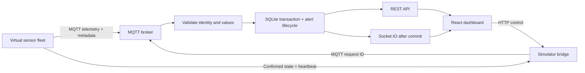
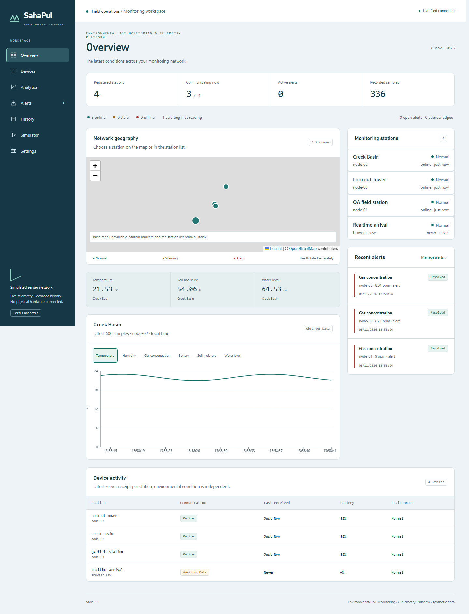
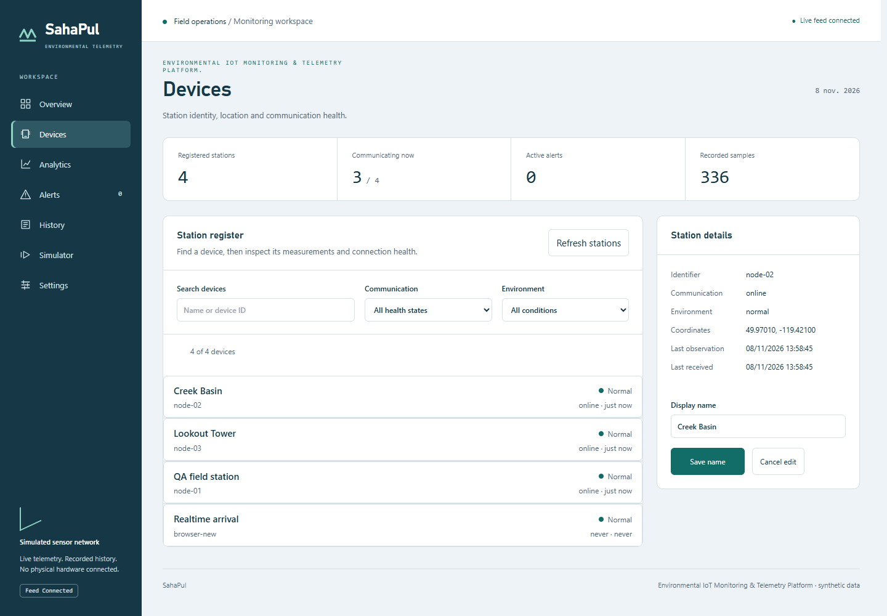
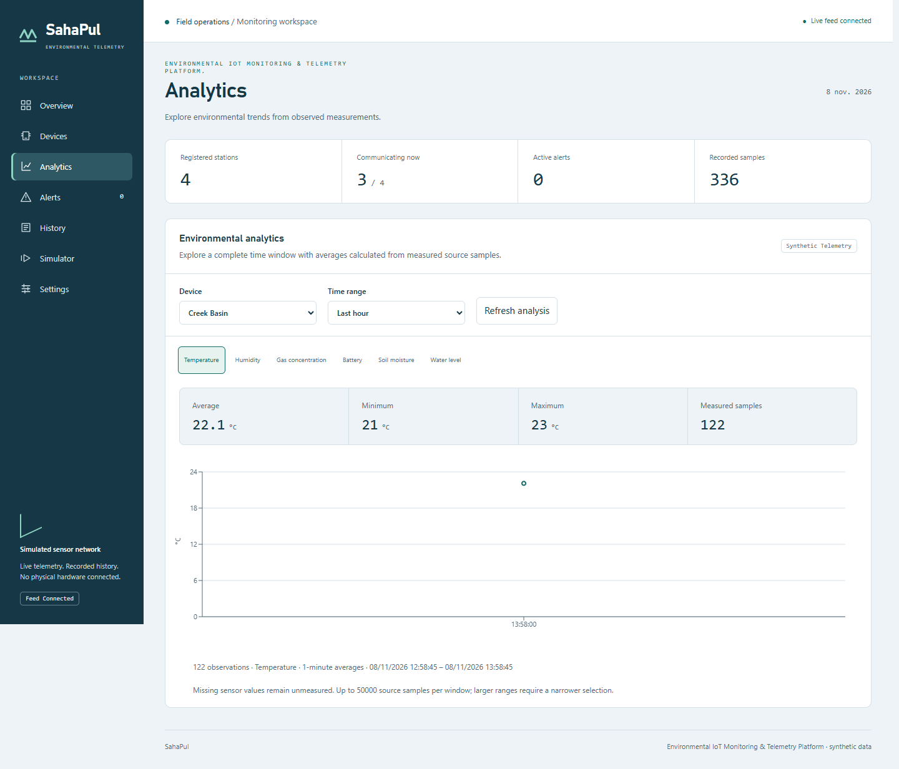
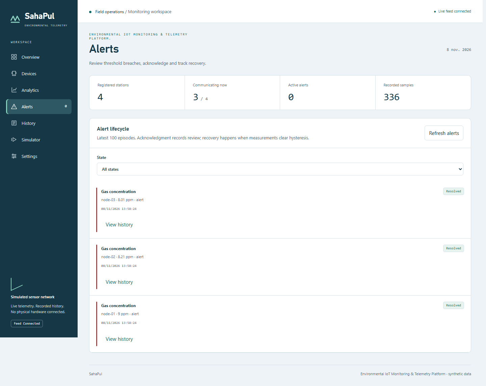
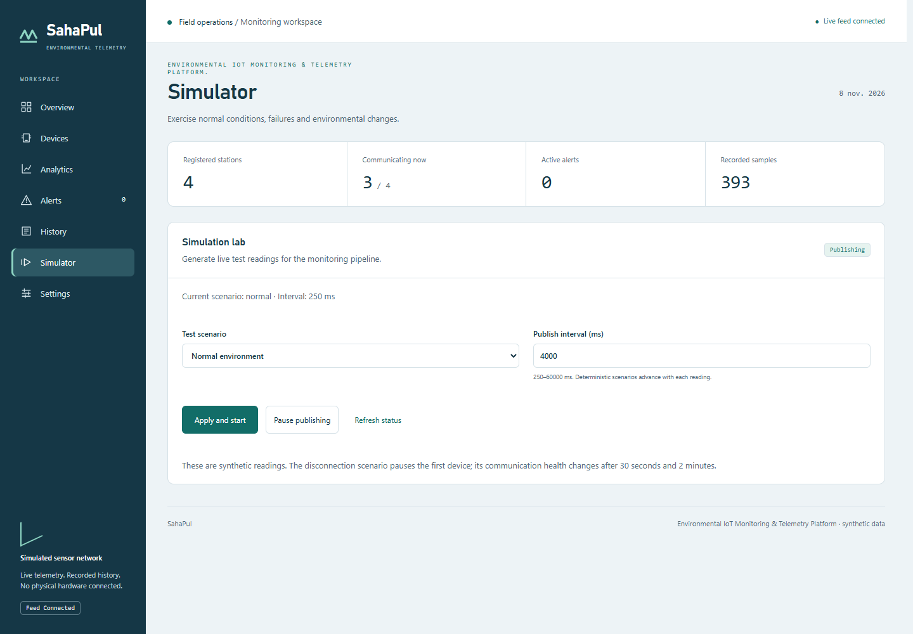

# SahaPul

**Environmental IoT Monitoring & Telemetry Platform.**

## Overview

SahaPul monitors a synthetic environmental sensor network from MQTT ingestion to stored history, alerts and a live React dashboard. It extends the original IoT LoRa Dashboard codebase; original MIT attribution remains intact. No physical LoRa radio, gateway or sensor is connected.

## Problem statement

Environmental monitoring requires distinguishing abnormal measurements from missing communication, preserving trustworthy history, and tracking alert episodes without creating a new notification every telemetry tick. SahaPul demonstrates these concerns with reproducible synthetic scenarios and testable service boundaries.

## Core features

- Temperature, humidity, gas, battery, coordinates, soil moisture and water level.
- Overview counts for online/stale/offline stations, open/acknowledged alerts, latest readings, trends and device activity.
- Searchable device inventory with communication/environment filters and persistent display names.
- Time-range analytics with device/metric selection, source-sample average/minimum/maximum and measurement counts.
- OPEN → ACKNOWLEDGED → RESOLVED alert episodes, hysteresis, cooldown and transition history.
- Validated transactional ingestion, persistent retransmission detection and after-commit realtime events.
- Historical data filtering/CSV export, confirmed simulator controls and read-only system diagnostics.

Displayed observations and counts come from the backend; missing sensors stay null. Synthetic telemetry is labeled.

## Technical architecture

Independent npm workspaces communicate over MQTT and REST/Socket.IO. The simulator and backend use Node/TypeScript; SQLite is embedded in the backend. The web app preserves the existing React, Leaflet and Recharts implementation. See [architecture](docs/architecture.md).

## Architecture diagram



## Technology stack

Node.js 22, npm 11, TypeScript, React 18, Vite 8, Express 4, SQLite/better-sqlite3, MQTT.js, Socket.IO, Zod 4, Tailwind 3, Recharts 2, Leaflet, Aedes for local development, Mosquitto for Compose, Vitest 5, Playwright and axe-core.

Recharts 2 is retained for compatibility; migrating its deprecated major is future work, not an untested dependency replacement. The scoped minimatch override and npm-generated lock remediate the previous development-tool advisory.

## Screenshots

These are real captures of the running project with synthetic data. Before-improvement captures are retained under docs/screenshots/before-submission. Some captures exercise the labeled unavailable-basemap state because external tiles are not guaranteed.



| Device inventory                                 | Environmental analytics                              |
| ------------------------------------------------ | ---------------------------------------------------- |
|  |  |

| Alert management                               | Simulator controls                                   |
| ---------------------------------------------- | ---------------------------------------------------- |
|  |  |

## Project structure

```text
server/       @sahapul/server — ingestion, SQLite, alerts, API and realtime
simulator/    @sahapul/simulator — synthetic fleet, scenarios and control
web/          @sahapul/web — seven monitoring views
mosquitto/    Compose broker configuration
scripts/      local broker, supervised development runner, test process helpers
tests/        root startup integration test and browser E2E suite
docs/         audit, architecture, protocol, schema, security, verification and screenshots
```

The old front/ and simulatoor/ directories were safely renamed in the earlier repair. The current workspaces and lock use web/, simulator/ and server/. The broker directory is mosquitto/, matching Compose.

## Requirements

Node.js **22.12+**, npm **11.x**, and a browser. Verified locally with Node 22.19.0 and a repository-local npm 11.21.2 runner. Microsoft Edge is used for Windows browser tests when installed; otherwise install Chromium through Playwright. Docker requires its engine to be running.

## Windows installation

In PowerShell at the repository root:

```powershell
node --version
npm --version
npm install
npm run dev
```

Use `npm run dev` from the repository root. There is no root `npm start` script; the workspace-specific `npm start` commands below run individual compiled services.

Open **http://127.0.0.1:5173/**. The root runner starts the loopback MQTT broker, backend, simulator and Vite. It reuses existing SahaPul services, refuses unrelated HTTP port conflicts, and stops only processes it started. Ctrl+C uses IPC for orderly backend/simulator shutdown with a bounded termination fallback. The root runner provides Vite hot reload; restart it after backend/simulator source edits.

For workspace watch mode, use four terminals:

```powershell
npm run dev:broker
npm run dev:server
npm run dev:simulator
npm run dev:web
```

These are four separate commands/terminals. Both localhost and 127.0.0.1 are accepted for the configured web origin's exact port. External origins remain rejected. Set PORT, WEB_PORT and MQTT_PORT on the root runner to use different ports. An explicit MQTT_URL uses your existing broker.

Compiled services:

```powershell
npm run build
npm start --workspace server
# In another terminal:
npm start --workspace simulator
# In another terminal:
npm run preview --workspace web -- --host 127.0.0.1 --port 5173
```

Npm 11's dependency install permissions are version-pinned in package.json for the existing better-sqlite3 and esbuild installers. Re-review those pins when upgrading either package. The system npm installation was not changed during this work.

## Docker installation

```powershell
Copy-Item .env.example .env
docker compose config
docker compose up --build
```

Four services: Mosquitto, simulator, backend and nginx for web assets. Dashboard 127.0.0.1:5173, API 127.0.0.1:4000, MQTT 127.0.0.1:1883. Host-published ports bind loopback. Named volumes preserve SQLite and broker state.

Stop with `docker compose down`; adding --volumes deletes data and is not a routine stop operation. Configuration validation passes. Actual startup was attempted and failed because the Docker engine is unavailable; container builds, Mosquitto startup and volume permissions are not claimed as verified.

If the Docker CLI cannot discover Compose, use the installed plugin directly. Here it is `C:\Program Files\Docker\cli-plugins\docker-compose.exe`.

## Environment configuration

Defaults run without copying templates. Optional per-workspace files:

```powershell
Copy-Item server/.env.example server/.env
Copy-Item simulator/.env.example simulator/.env
Copy-Item web/.env.example web/.env
```

| Service      | Settings                                                                                                                                                                  |
| ------------ | ------------------------------------------------------------------------------------------------------------------------------------------------------------------------- |
| Backend      | HOST (127.0.0.1), PORT (4000), MQTT_URL, MQTT_USERNAME/PASSWORD, MQTT_TOPIC_PREFIX (lora), DB_PATH, CORS_ORIGIN                                                           |
| Simulator    | MQTT connection settings; NODE_COUNT (1–1000, default 6); PUBLISH_INTERVAL_MS (250–60000, default 4000); ALERT_MODE; ALERT_PROBABILITY; ALERT_CHECK_INTERVAL_MS; SCENARIO |
| Frontend     | VITE_API_URL, baked into container builds; default API uses the browser's loopback hostname on port 4000                                                                  |
| Local runner | PORT, WEB_PORT, MQTT_PORT; optional external MQTT_URL                                                                                                                     |
| Broker       | MQTT_PORT (1883), loopback-only                                                                                                                                           |

Default workspace database is server/data/dashboard.sqlite. Npm workspace scripts resolve relative DB_PATH from server/. Direct node server/dist/index.js resolves relative paths from your current directory; use an absolute DB_PATH if needed. Root runner child processes use workspace directories. No .env or SQLite file is committed.

## MQTT topic structure

| Topic                   | Delivery                                   |
| ----------------------- | ------------------------------------------ |
| lora/{nodeId}/meta      | QoS 1, retained metadata                   |
| lora/{nodeId}/telemetry | QoS 1, non-retained reading                |
| lora/simulator/control  | QoS 1, non-retained command with requestId |
| lora/simulator/status   | Retained confirmed state and heartbeat     |

Topic and payload device IDs must match. Payloads are capped at 16384 bytes. Exact (device, timestamp, sequence) retransmissions are idempotent. Malformed values are rejected; MQTT reconnect does not accumulate application handlers. See [protocol and limits](docs/mqtt-protocol.md).

## Example telemetry payload

Protocol example only:

```json
{
  "nodeId": "node-01",
  "seq": 1,
  "ts": "2026-11-08T12:00:00.000Z",
  "temperatureC": 22.5,
  "humidityPct": 51,
  "gasPpm": 10,
  "batteryPct": 92,
  "soilMoisturePct": 55,
  "waterLevelCm": 65,
  "lat": 49.9812,
  "lng": -119.4012,
  "simulatedAlert": false
}
```

UTC/offset ISO dates normalize to UTC. Finite sensor values, safe sequences, identifiers and coordinates are bounded by Zod. Missing soil/water values remain null; old measurements are not fabricated.

## API reference

| Method      | Path                        | Behavior                                                                              |
| ----------- | --------------------------- | ------------------------------------------------------------------------------------- |
| GET         | /api/health/live            | HTTP liveness, independent of broker/database                                         |
| GET         | /api/health/ready           | 200 only when SQLite probe succeeds and MQTT is connected; otherwise 503              |
| GET         | /api/health                 | Version, liveness, readiness and separate SQLite/MQTT/simulator components            |
| GET         | /api/summary                | Actual stored sample count, active/open/acknowledged alerts and latest readings       |
| GET         | /api/nodes                  | Devices and independent environmental/communication states                            |
| GET / PATCH | /api/nodes/:id              | Read a device / update its display name                                               |
| GET         | /api/nodes/:id/readings     | ISO from/to, limit 1–5000, optional bucketMs                                          |
| GET         | /api/nodes/:id/analytics    | ISO from/to, bucketMs; full-window source statistics and buckets                      |
| GET         | /api/alerts                 | Optional nodeId, state and limit 1–5000                                               |
| POST        | /api/alerts/:id/acknowledge | Idempotent acknowledgment; 409 after resolution                                       |
| GET         | /api/alerts/:id/history     | Stored lifecycle transitions                                                          |
| GET         | /api/settings               | Thresholds, recovery margins, cooldown and communication policy                       |
| GET / POST  | /api/simulator              | Read confirmed status / apply running, scenario and intervalMs with MQTT confirmation |

Raw history returns newest 500 by default, maximum 5000, in chronological order; from/to are inclusive. Aggregation and analytics accept up to 50000 source samples and return 422 for larger ranges instead of truncating statistics. Analytics means are computed from measured source values, not averaged bucket means; missing sensors have no statistic. bucketMs is 1–2592000000.

The simulator is optional for readiness: pausing it does not make stored history unavailable. Socket.IO emits reading, alert transitions, node-status (environmental compatibility event) and full node records. Unknown devices return 404; invalid inputs 400; unavailable controls 503; unconfirmed controls 504.

## Database information

SQLite schema version 1: nodes, readings, alerts, alert_events. WAL on disk, foreign-key enforcement, busy timeout, parameterized queries, insertion constraints and persistent reading identity. Related ingestion writes commit atomically before events are emitted.

Automatic additive migrations preserve existing tables and rows. No schema change is introduced in the submission refinement. Latest-reading queries are anchored to devices rather than executing a correlated lookup per historical sample.

```powershell
npm run migrate --workspace server
```

Back up valuable data before migration. See [schema and backup notes](docs/database-schema.md).

## Running tests

```powershell
npm install
npm ls
npm run
npm test
npm run lint
npm run typecheck
npm run build
npm run format:check
npm run test:e2e
```

npm test runs every workspace plus an isolated startup/reuse/shutdown test. npm run test:startup runs that integration test alone. Build before browser E2E, which uses compiled services. If Edge is unavailable: `npx playwright install chromium`.

Tests use separate brokers, ports and temporary databases; they do not reset the user's database. Real-broker MQTT, real Socket.IO and actual browser flows are included. Exact current results and limits are in [testing.md](docs/testing.md).

## Security boundaries

Local-first, synthetic data; no accounts, customer profiles or personal-data collection. Loopback ports, exact origin checks, bounded validation, parameterized SQL and explicit native install-script approvals are implemented. The scoped minimatch security override is tested with the existing TypeScript tooling; the current dependency scan is recorded in [security-review.md](docs/security-review.md).

Authentication, authorization, per-device MQTT ACLs, TLS, rate/connection quotas and a retention/backup service are not implemented. Do not expose the demo publicly. This project is not production security certification.

## Current limitations

External map tiles can fail; the UI labels the unavailable basemap and retains station markers/list. Alert UI shows the newest 100 episodes, history the newest 5000 selected-window samples, analytics at most 50000. No physical sensor/gateway, multi-tenant deployment, long-duration soak or cross-browser certification is claimed. Docker startup requires verification on a running engine.

Three genuine low-severity original formatting/readability defects remain deliberately documented: relative-time boundary rounding, invalid relative-time fallback, and clock-only multi-day overview ticks. Analytics has its own date-aware ticks. See [open bug exercises](docs/open-bug-tasks.md).

## Engineering roadmap

[Initial audit](docs/initial-audit.md) · [Technical audit](docs/technical-audit.md) · [Architecture](docs/architecture.md) · [MQTT protocol](docs/mqtt-protocol.md) · [Backlog](docs/engineering-backlog.md) · [Submission report](docs/submission-report.md).

Priority future work: real deployment identity/TLS/ACLs, backup/retention, Mosquitto/container verification, Recharts migration, expanded browser/soak coverage, and physical-device provisioning if hardware enters scope.

## License and attribution

MIT © 2026 Mohamed Belmaizi — original [LICENSE](LICENSE) preserved unchanged. [THIRD_PARTY_NOTICES.md](THIRD_PARTY_NOTICES.md) records the evidence, modifications and dependency/asset notices. No original attribution is replaced and no private permission correspondence is published.
