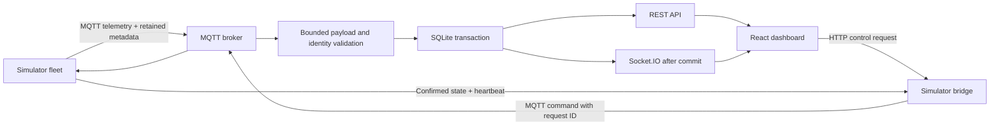

# SahaPul architecture

SahaPul extends the original simulated LoRa reference application. It has no physical radio, gateway or hardware integration. Synthetic telemetry is explicitly labeled throughout the UI.

## Runtime

- `simulator/`: virtual nodes, smooth synthetic measurements, original random alert episodes, deterministic scenarios and one guarded publishing runtime.
- `server/`: configuration validation, MQTT lifecycle, parsing, transactional ingestion, SQLite migrations, alert state transitions, routes and realtime adapter.
- `web/`: React/Vite UI; map/chart modules load separately. Seven views share device selection, tokens and data hooks.
- `mosquitto/`: broker configuration for Compose.
- `scripts/broker.mjs`: loopback-only Aedes broker for Windows development and automated tests. It stores no durable broker state.

## Ingestion invariants

Validate topic, payload identity, byte length, types, ranges and timestamp before writing. Convert ISO offsets to canonical UTC. Future telemetry beyond five minutes is rejected on the MQTT path. Within one synchronous transaction: ensure device association, check persistent replay identity, transition alerts, insert reading, and update current device state. Roll back every write on failure. Emit committed readings, status, alert transitions and full node records afterwards.

Identity is `(node_id, ts, seq)`. Sequence resets on simulator restart remain possible because timestamps differ. Exact retransmissions survive backend restarts without duplicate rows. This does not provide cryptographic replay protection or detect the same physical measurement with an altered timestamp/sequence.

Late readings retain their own evaluated severity and enter history, but do not regress current device state or trigger historical alert transitions. Receive time drives communication health; device observation time drives history and environmental transitions.

## Alerts

One episode per node/metric for newly ingested data. Sustained breaches update its latest value without creating repeated rows or notifications. OPEN can be acknowledged; escalation clears acknowledgment. RESOLVED occurs when readings clear the warning boundary plus recovery margin. Critical severity also has its own hysteresis band.

A breach within 60 seconds of recovery reopens the same episode; at 60 seconds or later, create a new episode. This merges noisy adjacent episodes while preserving transitions in `alert_events`. It never suppresses visibility of a new breach. Missing new sensor values cannot imply recovery. Legacy duplicate alert rows remain intact until genuine recovery resolves them; migration does not invent acknowledgments or recoveries.

## Resilience

HTTP starts even if MQTT is down. Subscriber handlers are registered before subscriptions, including retained metadata delivery; reconnect explicitly resubscribes. The simulator republishes metadata after reconnect, preserves paused state, skips disconnected publishing and does not overlap ticks. Shutdown stops timers, MQTT and sockets before closing SQLite with a five-second deadline.

The dashboard merges live updates with REST snapshots, cleans up listeners, cancels superseded requests, retries explicitly, and refetches on reconnect. Summary values refresh every five seconds, recent alerts every 15 seconds, simulator heartbeat/status every ten seconds. Counts reflect the database; missing values display —.

## Deployment boundaries

Single backend process and SQLite file. Local unauthenticated demonstration, bound to loopback by default. Compose uses Node 22 builders, the root npm lock, a SQLite volume and nginx for static assets. Docker startup was attempted but the Docker engine is unavailable in this environment. See security-review.md before considering external deployment.

Reference behavior was checked against [MQTT.js documentation](https://github.com/mqttjs/MQTT.js) and [SQLite PRAGMA documentation](https://sqlite.org/pragma.html).

## Submission refinements

The root dev runner supervises an actual local stack, detects existing SahaPul endpoints and stops only its own children. Windows shutdown uses IPC before a bounded fallback. Workspace watch scripts remain available independently.

Health/live is HTTP liveness; health/ready requires SQLite plus MQTT; health returns all components and version. Simulator availability is optional. Shared HTTP/Socket.IO origin policy permits only the configured origin and same-port loopback aliases by default.

DeviceInventory owns local name/ID/health/condition filtering. AnalyticsView requests full bounded source statistics and bucketed measurements through /api/nodes/:id/analytics. It displays source-weighted mean, extrema and actual per-metric measurement count. The newest-500 live series is retained for Overview rather than reused to claim whole-window analytics. Latest-per-node summary queries are anchored to nodes instead of historical rows.
